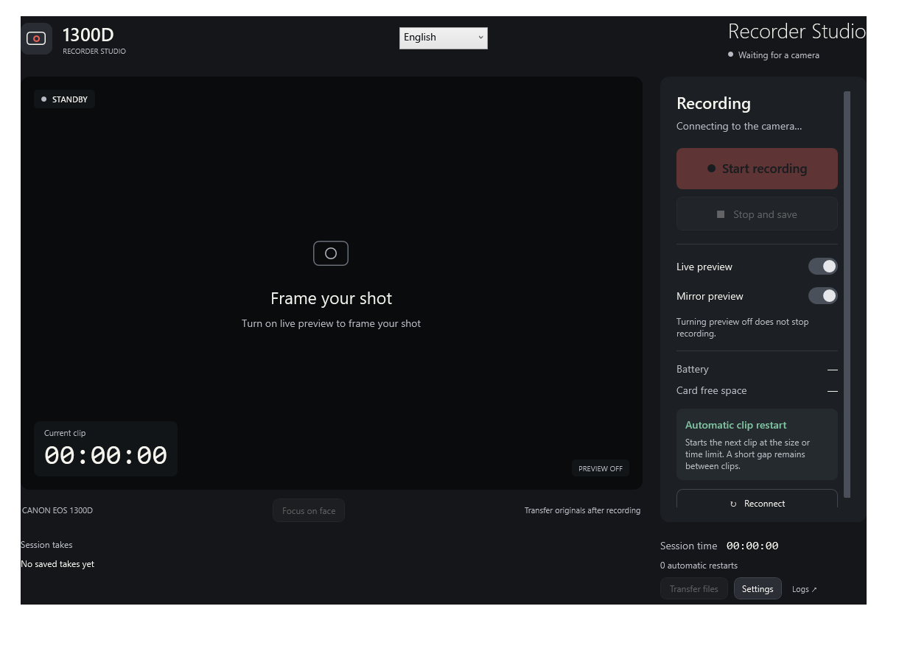

# Canon EOS 1300D / Rebel T6 Recorder Studio for Windows

**USB remote video recording, automatic clip restart, live preview and verified original-file transfers for the Canon EOS 1300D / Rebel T6 camera family.**

EOS 1300D Recorder Studio is a free, open-source Windows desktop companion for people recording talking-head videos, tutorials, interviews and other longer sessions with this older Canon DSLR. Start and stop recording from your computer, frame yourself with optional USB Live View, adjust supported camera settings, and receive audible battery warnings.

**English is the default language. فارسی / Persian is available immediately from the language selector.**

[Download the Windows app](https://github.com/kiatitano/canon-eos-1300d-rebel-t6-recorder/releases/latest) · [Persian guide](docs/README.fa.md) · [Setup and troubleshooting](docs/TROUBLESHOOTING.md) · [Contributing](CONTRIBUTING.md)



The screenshot shows the startup interface. No personal camera footage is included in this repository.

## What problem does it solve?

The EOS 1300D / Rebel T6 stops an individual internal movie recording when it reaches its file-size limit, or the camera's clip-duration limit. In Full HD, the 4 GB boundary can arrive at roughly 11–12 minutes, depending on the scene and encoding. This makes recording a longer presentation inconvenient.

This app watches recordings that it starts. When it verifies a completed clip at the camera's known size or time boundary, it starts the next clip automatically. You can finish the session from the computer and then choose whether to move the original MOV files to a local folder.

**Restart is not seamless recording. A short gap remains between clips.** In one physical-camera test, the next recording was confirmed about 2.5 seconds after the stop was detected. That observation is not a timing guarantee; file saving, camera state and USB communication can change the gap.

## Features

- **Remote movie Start / Stop:** records the camera's own movie files to its memory card, using the recording settings selected on the camera.
- **Automatic clip restart:** responds to a verified size/time limit, rather than blindly restarting after every manual stop or fault. Limited to 100 restarts per session.
- **Optional USB live preview:** turn the image on or off independently of recording; mirror the preview without mirroring the saved movie. The tested camera supplied a 1056 × 704 preview.
- **Face autofocus before recording:** uses the camera's Face Detection Live AF method. The lens must be switched to AF. It keeps receiving preview frames while waiting for focus feedback, with an adjustable timeout. It does not add continuous eye tracking.
- **Camera controls:** ISO, shutter speed, aperture, white balance, Picture Style and available Live View AF modes. Camera-provided choices are refreshed and new values are read back.
- **Picture Style details:** contrast, sharpness, saturation and color tone; monochrome filter/toning controls are exposed in the monochrome style. Availability depends on camera state.
- **Coarse battery monitoring:** a visible approximate level, low/critical banners and an original repeated-beep alert. Normal alerts use nine beeps; critical alerts use fifteen. Includes volume adjustment, mute, early warning and a sound test.
- **Keepalive and recovery:** sends the SDK keepalive command and retries connection after a camera disconnect, when enabled. A battery replacement does not silently begin a new recording.
- **Verified file movement:** asks before transfer, copies each completed movie twice, compares size and SHA-256, verifies the finalized local file, and only then removes that source from the card.
- **Transfer cancellation and progress:** completed transfers stay on the computer; unverified originals stay on the camera card.
- **English and Persian:** live language switching, appropriate text direction, localized labels/dialog content and persistent preferences.
- **Local operation:** no accounts, telemetry or automatic media uploads. Preferences and logs remain on your computer.

## Important limits

| Capability | What this app actually does |
| --- | --- |
| Original recording quality | Uses the camera's internal recording. Transfers copy original bytes without transcoding. |
| Recording without an SD card | Not supported. The movie is recorded to the card first. |
| Direct-to-PC Full HD video | Not provided by this app's USB Live View path. Preview is lower resolution than the internal movie. |
| Seamless unlimited recording | Not supported. Restart creates separate clips with missing time between them. |
| Clean HDMI | Not changed or enabled by this app. No capture card is required for its USB preview. |
| Continuous face/eye AF during movies | Not added. Use the pre-recording focus button and check sharpness. |
| Precise one-percent battery meter | Not available from this camera's coarse battery reporting. `≈` means approximate. |
| Resolution, frame rate and movie audio | Configure these on the camera. Controls unavailable through this model's SDK interface are disabled or explained. |
| Firmware modification | None. No Magic Lantern installation or camera bootflag changes. |

Camera overheating protection, an empty battery, USB cable faults, full storage and physical disconnection cannot be prevented by software. Use a charged battery or suitable continuous power for longer sessions and allow the camera to finish saving before removing power.

## Supported camera and Windows requirements

- **Hardware-tested:** Canon EOS 1300D, firmware 1.1.0, with an EF-S 18–55mm f/3.5–5.6 III lens.
- **Regional names recognized:** Canon EOS Rebel T6 and EOS Kiss X80. These branded variants have not been separately tested on physical units.
- **Not the same camera:** Rebel T6i / T6s and other EOS bodies are not supported by this release.
- Windows with **.NET Framework 4.8** and WPF. The app is built as **x86** so it can load the compatible 32-bit EDSDK installation tested with the camera.
- A compatible **32-bit Canon EDSDK installation**, usually provided by the separately installed Canon EOS Utility. Canon DLLs are not bundled. A 64-bit-only DLL cannot be loaded by this build.
- A working USB data cable, a recognized memory card, adequate card/destination space and camera power.

The app was developed and hardware-tested on Windows. Linux, macOS, Wine, ARM and other camera models are not verified targets. More camera support requires implementation and real testing, not just bypassing the model check.

## Download and first run

1. Download and extract the Windows x86 ZIP from [Releases](https://github.com/kiatitano/canon-eos-1300d-rebel-t6-recorder/releases). Keep the executable and its `.config` file together.
2. Install compatible Canon EOS Utility separately from [Canon support](https://www.usa.canon.com/support/p/eos-rebel-t6). This project does not distribute SDK downloads or vendor DLLs.
3. Close EOS Utility and other programs that may hold an exclusive camera session.
4. Turn the camera on, connect its USB data cable, insert a card and set the physical dial to Movie mode. Disable camera Wi-Fi if it prevents USB operation.
5. Run `EOS1300DRecorder.exe`. No administrator privileges are requested.
6. If SDK detection fails, open **Settings → App preferences → Canon SDK location** and select the folder containing a compatible 32-bit `EDSDK.dll` and its installed dependencies.
7. Choose your transfer folder. Fresh installs default to **Videos\EOS 1300D Recorder**. Existing prototype preferences can migrate their previous destination.
8. Turn on **Live preview**, frame your shot, and focus before pressing **Start recording**.

Keep the computer awake and the USB connection intact. While it owns a recording or transfer, the app requests that Windows not automatically sleep; it does not override a manual shutdown, forced sleep, lid action or power loss.

## Recording and autofocus workflow

1. Position and light yourself before recording.
2. Set the lens AF/MF switch to **AF** if you want software-controlled focus.
3. Press **Focus on face** and stay still while the lens settles. The app keeps live frames flowing and waits up to the configured timeout. A focus confirmation may not be reported by every camera state; inspect the preview instead of assuming that an accepted command means sharp eyes.
4. Press **Start recording**. The preview can remain on, be mirrored, or be turned off to reduce computer work.
5. At a verified clip limit, the next take starts automatically. A normal early stop is left stopped.
6. Press **Stop and save** to end the session and save the current clip.

When you move the camera or significantly change your distance, focus again before the next take. This older contrast-detection system can hunt in low light or with difficult subjects. The app does not manufacture autofocus capabilities absent from the camera.

Keyboard shortcuts:

| Shortcut | Action |
| --- | --- |
| `Ctrl+R` | Start recording |
| `Ctrl+S` | Stop and save |
| `F8` | Toggle live preview |
| `Esc` in Settings | Close Settings |

## Transfer originals and free the card

After stopping, a confirmation shows the number of pending takes and the destination:

- **No:** all originals stay on the card. You can use **Transfer files** later while this app instance remains open.
- **Yes:** moves only the pending recordings created by this app instance. Unrelated older card files are not selected.

For each take, the app:

1. Finds a unique card file matching its recorded name, size and camera timestamp.
2. Downloads it to a new temporary local file without conversion.
3. Independently downloads it again and compares the two sizes and SHA-256 hashes.
4. Finalizes the destination, verifies it against the same trusted hash, and holds it against writers while removing the verified source.
5. Writes a verification receipt next to the transferred movies.

The second read adds transfer time and temporary-space requirements. The destination must have room for the pending files plus another copy of the largest file. Failures or cancellation preserve unverified sources; `.partial` / `.verify` files may remain for inspection. A transfer can be partially complete when cancelled: already verified files may have been moved, while the remaining originals stay on the card.

**Pending takes are currently kept in memory.** Closing the app after declining transfer does not delete them, but it does not rebuild that pending list next launch. Use Canon EOS Utility or a card reader for older files, or transfer before closing the app.

## Settings and language

The header selector changes between **English** and **فارسی**. English is the fresh-install default. Settings are organized into:

- **Camera:** supported camera values, current-value display, Apply actions, focus adjustments and explanations of body-only settings.
- **App preferences:** language, transfer destination, sound alerts and volume, 30%/50% warning level, reconnect behavior, preview on startup, AF timeout and SDK folder.
- **About & help:** limitations, shortcuts, project link and local log folder.

Battery percentages are camera-reported levels, not estimates of remaining minutes. A 30% indication can persist and later drop to the last level. Choose early warning when you need more time to replace a battery. Alert volume does not change the Windows system volume; use the test button to confirm your selected audio output.

Preferences and logs are stored under `%LOCALAPPDATA%\EOS 1300D Recorder`. Technical SDK diagnostics can remain in English in either UI language.

## Build from source

No NuGet packages, camera SDK binaries or network downloads are required by the build script:

```powershell
powershell -NoProfile -ExecutionPolicy Bypass -File .\scripts\Build.ps1
```

Output: `dist\EOS1300DRecorder.exe`. The PowerShell execution-policy option applies to that process; it does not change your global execution policy. You can also inspect the included project file in an appropriate Windows MSBuild environment.

To build the portable release ZIP and checksum:

```powershell
.\scripts\Build.ps1 -Package
```

Run the offline tests:

```powershell
.\scripts\Test.ps1
```

Tests cover the generated beep waveform, corrupt/truncated copy rejection, verification-hash anchoring, cancellation before camera access, bilingual rendering, language switching and filename preservation. Offline tests do not control a camera or delete camera files.

Hardware tests from development verified remote start/stop, preview off/on while recording, original-file moves after verification, camera-setting change/readback/restore, SDK session recovery and a real 4 GB boundary restart. These observations do not cover every lens, USB controller, power condition or many-hour recording scenario. See [testing notes](docs/TESTING.md).

## Project structure

```text
src/
  Interop/       Minimal Canon SDK and Win32 declarations
  Localization/  English source text + Persian catalog
  Models/        Camera settings and status models
  Services/      Recording, transfers, preferences, SDK discovery, beep synthesis
  Views/         WPF monitor UI and tabbed settings
scripts/         Build, test and desktop-shortcut helpers
tests/           Offline tests; no bundled camera media
docs/            Setup, testing, architecture and Persian guide
assets/          App-only screenshots without personal footage
```

## Troubleshooting

- **Camera not found:** use a data-capable USB cable, power the camera on, check Windows device recognition and close other camera apps.
- **Camera busy / session error:** EOS Utility or another app may own the camera. Close it and reconnect.
- **SDK not found / cannot load DLL:** select the compatible **32-bit** SDK folder. Install the full Canon software and dependencies rather than obtaining random DLL files.
- **Preview frozen:** the app clears stale frames after a few seconds. Check USB/power and the camera's Movie mode.
- **Focus makes the image blurrier:** check the lens AF switch, subject distance and light. Stay still while focusing; verify the face in the image. Use the small nearer/farther adjustments when needed.
- **Battery alert never sounds:** enable alerts, raise the app volume, use Test beep alert and check the Windows output/mute state.
- **Recording stops without a restart:** manual stops and unverified faults are intentionally not blindly restarted. Check the log, battery, card space and temperature.
- **Transfer failed:** keep the originals on the card, check destination space and connection, and inspect the reported error before retrying.

More details: [Troubleshooting](docs/TROUBLESHOOTING.md).

## Contributions and feedback

Bug reports with the Windows version, camera model/firmware, lens and steps to reproduce are welcome. Remove private paths and personal data from logs before attaching them. Do not upload personal footage, Canon DLLs, account credentials or unrelated card files.

If you test a Rebel T6 / Kiss X80 branded unit, report your exact model string and the features tested. Please do not advertise other cameras as supported until the implementation is reviewed and hardware-tested.

## License and acknowledgements

Project source is available under the [MIT license](LICENSE). Canon software has its own terms and is not included. Read [NOTICE.md](NOTICE.md) for the dependency and compatibility boundaries.

This project is an unofficial utility, not a Canon product. It is intended to make the existing EOS 1300D / Rebel T6 recording workflow easier without claiming to remove hardware limitations.
